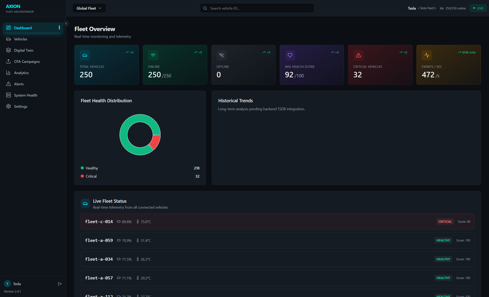

<p align="center">
  
</p>

<h1 align="center">Axion — EV Fleet Management Platform</h1>

<p align="center">
  <b>Vendor-Neutral EV Fleet Telemetry · Digital Twin · OTA Orchestration</b><br/>
  <sub>Event-driven platform managing 250 electric vehicles in real-time</sub>
</p>

<p align="center">
  
  
  
  
  
  
  
</p>

---

## Quick Start

```bash
git clone https://github.com/Animesh-86/Axion-EV-Fleet-Management.git
cd Axion-EV-Fleet-Management

# Copy environment template
cp .env.example .env

# Run the 1-click deployment script
# On Windows:
deploy.bat

# On Linux / Mac:
./deploy.sh
```

Open http://localhost — live enterprise dashboard monitoring the active fleet.

---

## Overview

Axion is an **enterprise-grade, event-driven EV fleet management platform** built for high-throughput telemetry ingestion, real-time digital twin tracking, explainable AI health scoring, and resilient over-the-air (OTA) orchestrations. 

Engineered with a **production-first mindset**, the platform leverages Spring Boot, Spring WebFlux (for non-blocking concurrent I/O), Apache Kafka (for decoupled linear stream processing), Mosquitto MQTT, TimescaleDB, PostgreSQL with PgVector, and Redis (for distributed coordination and low-latency twin storage).

---

## Production-Grade Architecture

To scale seamlessly to hundreds of concurrent electric vehicles under unreliable network conditions, Axion utilizes a decoupled, linear event-driven pipeline that guarantees zero data loss, low database contention, and robust edge validation.

```
┌────────────────────────────────────────────────────────────────────────┐
│                     AXION ENTERPRISE ARCHITECTURE                      │
├────────────────────────────────────────────────────────────────────────┤
│                                                                        │
│  [250+ simulated EVs]               [Enterprise Dashboard (React 18)]  │
│   HTTP / MQTT Client                    STOMP WebSocket / REST API     │
│         │                                        ▲                     │
│         ▼ (Edge Security)                        │ (Throttled 1/sec)   │
│  [Mosquitto MQTT Broker]                         │                     │
│    └─► Validation (VehicleRegistry)              │                     │
│  [Spring Boot Ingestion REST]                    │                     │
│         │                                        │                     │
│         ▼ Ingest (Throughput metrics)            │                     │
│   (Topic: telemetry.normal)                      │                     │
│  [Apache Kafka Ingress]                          │                     │
│         │                                        │                     │
│         ▼ Consume                                │                     │
│  [TelemetryConsumer]                             │                     │
│         │                                        │                     │
│         ├─► Schema Validation & Registry checks  │                     │
│         ├─► Digital Twin Engine & Health Scoring │                     │
│         │                                        │                     │
│         ▼ Digital Twin State & Broadcast         │                     │
│     [Redis 7.0 Cache] (120s TTL) ────────────────┘                     │
│         │                                                              │
│         ▼ Publish (Topic: telemetry-enriched)                          │
│  [TelemetryHistoryConsumer]                                            │
│         │                                                              │
│         ▼ Chunk-Partitioned Hypertables                                │
│     [TimescaleDB] (Historical Time-Series Analytics)                   │
│         ▲                                                              │
│         │ Predictive Features                                          │
│     [FastAPI ML Service] (XGBoost Battery & Thermal Forecaster)        │
│         ▲                                                              │
│         │ Vector Embeddings & RAG                                      │
│     [PostgreSQL 16 + PgVector] ◄──► [Spring AI Assistant]              │
│                                                                        │
└────────────────────────────────────────────────────────────────────────┘
```

### Production Telemetry Pipeline
1. **Edge Authorization**: Incoming telemetry over MQTT and REST is authorized against the `VehicleRegistryService` cache to validate active provisioned assets.
2. **Ingress Buffer (`telemetry.normal`)**: Ingested payloads are canonicalized using the Adapter Pattern and published asynchronously to Kafka's `telemetry.normal` topic.
3. **Twin Synchronization & Scoring**: `TelemetryConsumer` pulls from `telemetry.normal`, updates the in-memory authoritative `DigitalTwinState` in Redis, calculates dynamic multi-factor health scores, and dispatches real-time STOMP WebSocket notifications.
4. **Enriched History Streaming (`telemetry-enriched`)**: Digital twin updates are forwarded to `telemetry-enriched`, where `TelemetryHistoryConsumer` executes high-throughput batch writes into TimescaleDB hypertables.
5. **Predictive Intelligence & RAG**: The dedicated FastAPI microservice evaluates degradation trends and thermal anomaly risks, while Spring AI and PgVector power conversational root-cause diagnosis.
6. **WebSocket Throttling**: A per-vehicle atomic debouncer limits UI broadcast frequency to a maximum of 1 update per second per vehicle to prevent client render thrashing.

---

## Key Features & Hardened Infrastructure

### Edge Security & Dual-Protocol Ingestion
- **Protocols**: Low-overhead MQTT (Eclipse Mosquitto) and high-throughput REST (HTTP POST).
- **Edge Security**: Strict whitelist checks against a synchronized `VehicleRegistry` at ingestion time to prevent malicious packet injection.
- **Dependency Injection**: Fully clean Spring IoC architecture with constructor injection and annotated `@Component` mappings, entirely removing unmanageable `new` adapter/validator instances.

### Non-Blocking Reactive Orchestration
- **WebClient Integration**: Stalling REST calls (previously blocked on `RestTemplate`) have been completely replaced with a fully concurrent, non-blocking `WebClient` integration to fetch real-time battery degradation predictions.
- **Throttling**: Dual-layered debouncing prevents downstream database and UI congestion while retaining data fidelity inside Kafka.

### Digital Twin Engine & Distributed Locks
- **Redis Cache**: Authoritative digital twin states indexed by `vehicleId` with a 120-second automatic TTL expiry.
- **Distributed Lock Management**: The GenAI Anomaly Explainer utilizes a distributed Redis Lock manager (`setIfAbsent` with 15-minute global TTL) instead of local in-memory caches. This prevents concurrent LLM invocation storms and redundant token consumption when scaling backend replicas across multiple Kubernetes pods.

### Micrometer Observability (Prometheus & Grafana Ready)
- **Engineered Metrics**: Ripped out volatile custom array-based sliding windows, implementing native Spring **Micrometer Instrumentation** via `MeterRegistry`.
- **Metrics Tracked**: High-speed concurrency-safe telemetry throughput counters, processing latency timers, and payload validation failure meters.

### Hardened OTA Simulation & State Machine
- **State Flow**: Gated state transitions: `PENDING → IN_PROGRESS → SUCCESS / FAILURE`.
- **Asynchronous Execution**: Simulated downloads and installations are executed via Spring `@Async` threads using non-blocking asynchronous delays (`Thread.sleep(3000)` within an executor pool). This preserves the critical `IN_PROGRESS` duration required for realistic frontend polling, rather than executing instantaneously.
- **Safety**: Updates automatically reject if the twin state indicates low state-of-charge (<20% SOC) or thermal warnings (>45°C).

### Explainable GenAI Intelligence
- **RAG Capability**: Dynamic anomaly identification powered by Spring AI linked to a `PgVector` vector database.
- **Conversational Ops**: Continuous streaming Server-Sent Events (SSE) chat broker allowing operators to interactively diagnose anomalies in plain natural language.

### Premium Glassmorphic Dashboard
- **Visuals**: Dark-themed modern React 18 UI built with Tailwind CSS, Framer Motion, and Shadcn UI.
- **Dynamic Views**: 6 animated KPI cards, interactive Recharts graphs, real-time alert logs, custom OTA campaign controller, and a fully interactive GenAI SSE chat assistant.

### Async Python Simulator
- **Simulation**: High-concurrency `asyncio` engine representing a fleet of 250 vehicles.
- **Scenarios**: 5 hot-swappable telemetry profiles (Normal Drive, Rapid SOC Drain, High-Temp Spike, GPS/Network Dropout, OTA trigger) loaded dynamically from YAML files.


## Technology Stack

| Layer | Technology |
|-------|-----------|
| **Backend** | Java 21, Spring Boot 3.2, Spring WebFlux |
| **Messaging** | Apache Kafka (Confluent 7.5), Zookeeper |
| **MQTT** | Eclipse Mosquitto 2.0 |
| **GenAI / Vector** | Spring AI, PgVector (pgvector/pgvector:pg16), OpenAI |
| **State Store** | Redis 7.0 Alpine |
| **Frontend** | React 18, TypeScript, Vite, Tailwind CSS, Shadcn UI |
| **Charts** | Recharts, Framer Motion |
| **Simulator** | Python 3.12, asyncio, YAML config |
| **Deployment** | Docker, Docker Compose (7 containers) |

---

## Project Structure

```
Axion-EV-Fleet-Management/
├── Axion-Backend/
│   └── ingestion/
│       └── src/main/java/com/axion/ingestion/
│           ├── adapter/        # Vendor telemetry adapters & normalization
│           ├── api/            # Fleet, vehicle, OTA, and admin REST controllers
│           ├── config/         # Kafka, Redis, MQTT, WebSocket, and Security configs
│           ├── consumer/       # Kafka stream consumers (normal & history)
│           ├── controller/     # Auth, AI assistant, and registry controllers
│           ├── health/         # HealthScoreEngine rule-based scoring
│           ├── model/          # Primary entities, TSDB entities, and DTOs
│           ├── mqtt/           # Eclipse Mosquitto MQTT message handler
│           ├── producer/       # Kafka telemetry and enriched stream producers
│           ├── repository/     # JPA & vector store repositories
│           ├── security/       # JWT auth filters & configurable security
│           └── service/        # Digital twin, OTA campaign, RCA & ML services
├── Axion-Frontend/
│   └── src/
│       ├── app/                # Application routes, shell layouts, and pages
│       ├── components/         # Dashboard, vehicle, OTA, alerts, and system views
│       ├── hooks/              # useWebSocket with automatic reconnection
│       ├── services/           # Authenticated API client and auth context
│       └── config.ts           # Centralized intervals, ports, and thresholds
├── Axion-ML/
│   ├── main.py                 # FastAPI service & prediction REST endpoints
│   ├── ml_service.py           # CatBoost & Random Forest ensemble, anomaly detection
│   └── database.py             # TimescaleDB & pgvector connections
├── Axion-Simulator/
│   ├── core/                   # Vehicle physics, clock, connection state
│   ├── scenarios/              # Fault injection (drain, temp spike, dropout)
│   ├── emitters/               # Async REST & MQTT telemetry emitters
│   ├── ota/                    # OTA update receiver simulation
│   ├── profiles/               # Vehicle profiles (sedan, truck, performance)
│   └── config/fleet.yaml       # Fleet configuration (250+ vehicles)
├── Design/                     # Architectural diagrams & dashboard UI assets
├── Project Docs/               # Evaluation sheets, testing guides, demo scripts
├── docker-compose.yml          # Production multi-service orchestration
└── README.md
```

---

## Deployment

### 1-Click Deployment (Recommended)

To completely spin up the stack, tear down any old conflicting containers, and ensure a clean environment, simply use the deployment scripts:

**Windows:**
```cmd
deploy.bat
```

**Linux / macOS:**
```bash
./deploy.sh
```

### Load Testing Simulation
To test the backend ingestion pipeline with high-throughput telemetry (100 concurrent vehicles), we provide a containerized load-tester. You don't need Python installed on your host machine to run this.

```bash
docker compose --profile testing up load-tester -d
```

### Troubleshooting
**Port Conflicts (e.g. 8080 or 5432 is already in use):**
If you see an error like `bind: Only one usage of each socket address is normally permitted`, it means you have a local process (like a local Postgres or a rogue Java process) holding that port. Ensure you shut down local databases or Spring Boot apps before running the deploy script.

| Container | Role | Image | Port |
|-----------|------|-------|------|
| `axion-frontend` | React 18 Operations UI | Vite / Nginx | `:80` |
| `axion-backend` | Telemetry & Twin Engine | Spring Boot 3.2 | `:8080` |
| `axion-simulator` | 250+ Node EV Simulation | Python 3.12 (asyncio) | — |
| `axion-ml` | Predictive ML Service | FastAPI + XGBoost | Internal `:8000` |
| `axion-kafka` | Event Streaming Backbone | Confluent Kafka 7.5 | `:9092` |
| `axion-zookeeper` | Cluster Coordination | Confluent Zookeeper 7.5 | `:2181` |
| `axion-redis` | Authoritative Twin Cache | Redis 7.0 Alpine | `:6379` |
| `axion-mosquitto` | Edge IoT Ingestion Broker | Eclipse Mosquitto 2.0 | `:1883` |
| `axion-postgres` | Relational Metadata & RAG | PostgreSQL 16 + PgVector | `:5432` |
| `axion-timescaledb` | Historical Hypertables | TimescaleDB (PG 16) | `:5433` |
| `axion-prometheus` | Metrics Collector | Prometheus Latest | `:9090` |
| `axion-grafana` | Infrastructure Observability| Grafana Latest | `:3001` |

**Startup order** (automatic via healthchecks): Zookeeper → Kafka → Redis → Mosquitto → PostgreSQL → TimescaleDB → Backend → Frontend + Simulator + ML → Prometheus + Grafana

### Development Mode

```bash
# 1. Start development infrastructure (Databases, Broker, Cache)
docker compose -f docker-compose.dev.yml up -d

# 2. Run backend (hot-reload on :8080)
cd Axion-Backend/ingestion && ./mvnw spring-boot:run

# 3. Run frontend (hot-reload on :5173)
cd Axion-Frontend && npm run dev

# 4. Run ML service (on :8000)
cd Axion-ML && uvicorn main:app --reload --port 8000

# 5. Run simulator
cd Axion-Simulator && python main.py
```

---

## API Reference

| Domain | Method | Endpoint | Description |
|--------|--------|----------|-------------|
| **Auth** | `POST` | `/api/v1/auth/login` | Authenticate operator & receive JWT token |
| **Auth** | `POST` | `/api/v1/auth/register` | Register new fleet operator |
| **Ingestion** | `POST` | `/api/v1/telemetry` | Ingest vehicle telemetry payload via HTTP |
| **Fleet** | `GET` | `/api/v1/fleet/summary` | Fleet KPIs (total, online, health distribution) |
| **Fleet** | `GET` | `/api/v1/fleet/vehicles` | Paginated fleet digital twins from Redis |
| **Fleet** | `GET` | `/api/v1/fleet/risk-ranking`| ML-derived fleet risk prioritization |
| **Fleet** | `POST` | `/api/v1/fleet/ml-retrain` | Trigger automated ML model retraining |
| **Vehicle** | `GET` | `/api/v1/vehicles/{id}` | Detailed single vehicle twin & predictions |
| **History** | `GET` | `/api/v1/history/{id}` | TimescaleDB telemetry time-series |
| **History** | `GET` | `/api/v1/history/{id}/aggregates` | Time-bucketed battery/thermal rollups |
| **OTA** | `POST` | `/api/v1/ota/campaigns` | Initialize multi-vehicle OTA campaign |
| **OTA** | `GET` | `/api/v1/ota/campaigns` | List all historical and active OTA campaigns |
| **OTA** | `POST` | `/api/v1/ota/campaigns/{id}/approve` | Promote campaign to canary rollout |
| **OTA** | `POST` | `/api/v1/ota/campaigns/{id}/halt` | Emergency halt & rollback campaign |
| **OTA** | `POST` | `/api/v1/ota/trigger` | Single-vehicle safety-gated firmware update |
| **RCA** | `GET` | `/api/v1/rca/{id}` | Root Cause Analysis incident timeline |
| **Assistant** | `POST` | `/api/v1/ai/chat/stream` | Streaming SSE GenAI fleet copilot query |
| **Assistant** | `GET` | `/api/v1/ai/explanations/{id}` | Retrieve GenAI anomaly explanations |
| **Registry** | `POST` | `/api/v1/registry/provision` | Provision new vehicle asset into registry |
| **Admin** | `POST` | `/api/v1/admin/vehicles` | Admin vehicle creation & simulator sync |
| **Admin** | `POST` | `/api/v1/admin/ai-key` | Runtime configuration of OpenAI API key |
| **Observability** | `GET` | `/actuator/prometheus` | Prometheus Micrometer scrapable metrics |
| **Streaming** | `WS` | `/ws` (STOMP/SockJS) | Real-time fleet and vehicle telemetry push |


## Disclaimer

Axion simulates OTA updates and vehicle behavior for academic and demonstration purposes only. It does not perform real firmware updates on physical vehicles.

## License

This project is developed for academic use. Licensing terms can be defined as required.